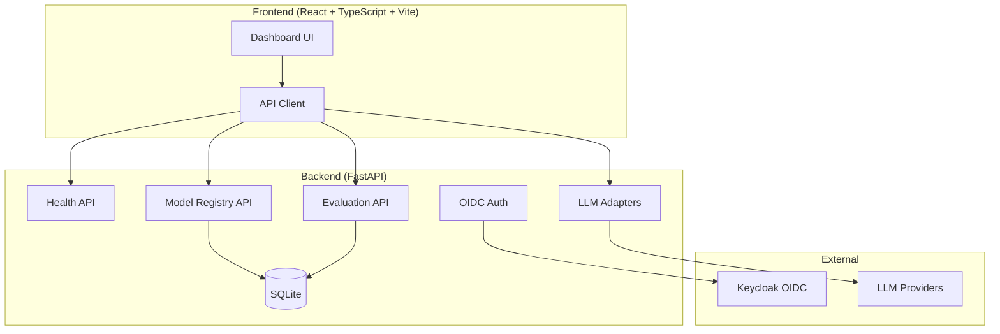

# Orbit Hub — Ryan Vo

> Work in progress. This checkpoint may be incomplete or fail tests. See PLAN.md and STATUS.md before use.


**Ryan Vo | AI & Machine Learning**

Orbit Hub is a developer toolkit for managing, evaluating, and deploying AI/ML models. It provides a model registry, evaluation workflows, and LLM provider integration — built with FastAPI and React.

## Problem

AI/ML developers need a lightweight, self-hosted tool to track model versions, run reproducible evaluations, and integrate with multiple LLM providers without vendor lock-in. Existing solutions are either heavyweight MLOps platforms or simple notebooks without structure.

## Approach

Orbit Hub implements a modular FastAPI backend with SQLite persistence and a React TypeScript frontend. The core domain engine provides:

- **Model Registry**: CRUD operations for ML models with metadata, tags, and versioning
- **Evaluation Engine**: Run benchmark jobs against registered models with configurable metrics
- **LLM Provider Adapters**: Unified interface for OpenAI-compatible, Anthropic, Gemini, and Ollama providers
- **OIDC Authentication**: Keycloak integration with SAML broker support for enterprise SSO

## Quick Start

### Prerequisites
- Docker and Docker Compose
- Or Python 3.12+ and Node 24+ for local development

### Docker (Recommended)

```bash
docker compose up --build
```

Frontend: http://localhost:5173  
Backend API: http://localhost:8000/api/v1  
Health check: http://localhost:8000/api/v1/health

### Local Development

**Backend:**
```bash
cd backend
python -m venv .venv
source .venv/bin/activate
pip install -r requirements.txt
cp ../.env.example .env
uvicorn app.main:app --reload --port 8000
```

**Frontend:**
```bash
cd frontend
npm install
npm run dev
```

## Architecture



## API Reference

### Health
- `GET /api/v1/health` — Service health check

### Models (planned)
- `POST /api/v1/models` — Create model
- `GET /api/v1/models` — List models (paginated, filterable)
- `GET /api/v1/models/{id}` — Get model
- `PATCH /api/v1/models/{id}` — Update model
- `DELETE /api/v1/models/{id}` — Delete model

### Evaluations (planned)
- `POST /api/v1/evaluations` — Run evaluation
- `GET /api/v1/evaluations` — List evaluations
- `GET /api/v1/evaluations/{id}` — Get evaluation results

## AI/ML Evaluation

Orbit Hub includes a reproducible evaluation workflow for benchmarking models:

```bash
# Run evaluation (planned)
curl -X POST http://localhost:8000/api/v1/evaluations \
  -H "Content-Type: application/json" \
  -d '{"model_id": "model-uuid", "dataset": "mmlu", "metrics": ["accuracy", "f1"]}'
```

**Baseline**: TBD — evaluation engine not yet implemented.

**Data Provenance**: Evaluation datasets are user-provided or fetched from standard benchmarks (Hugging Face, etc.).

**Failure Cases**: Network timeouts, provider rate limits, malformed model outputs, dataset schema mismatches.

## Security

- OIDC authentication via Keycloak (PKCE flow)
- JWT token validation with issuer/audience verification
- HttpOnly SameSite cookies for session management
- CSRF protection on state-changing operations
- No hardcoded secrets; all credentials via environment variables
- Demo mode binds to localhost only; refuses startup in production

## LLM Provider Configuration

| Provider | LLM_PROVIDER | LLM_BASE_URL (optional) | Notes |
|----------|--------------|-------------------------|-------|
| OpenAI | `openai-compatible` | `https://api.openai.com/v1` | Standard |
| LiteLLM | `openai-compatible` | `http://localhost:4000` | Proxy |
| OpenRouter | `openai-compatible` | `https://openrouter.ai/api/v1` | Aggregator |
| Ollama | `ollama` | `http://localhost:11434` | Local |
| Anthropic | `anthropic` | `https://api.anthropic.com` | Messages API |
| Gemini | `gemini` | `https://generativelanguage.googleapis.com` | generateContent |

Set `LLM_API_KEY` for the selected provider. All keys server-side only.

## SSO / SAML Setup

Keycloak supports SAML identity providers via Identity Brokering:

1. Configure SAML IdP in Keycloak Admin Console → Identity Providers → SAML v2.0
2. Import realm: `docker compose exec keycloak /opt/keycloak/bin/kc.sh import --dir /realm`
3. Map SAML attributes to Keycloak user attributes
4. Set `OIDC_ISSUER_URL` to your Keycloak realm URL

## Backup & Restore

```bash
# Backup SQLite
cp backend/data/orbit.db orbit-backup-$(date +%F).db

# Restore
cp orbit-backup-2026-10-22.db backend/data/orbit.db
```

For production, use PostgreSQL with pg_dump/pg_restore.

## TLS / Reverse Proxy

In production, terminate TLS at a reverse proxy (nginx, Traefik, Caddy):

```nginx
server {
    listen 443 ssl;
    server_name orbit.example.com;

    ssl_certificate /etc/ssl/certs/orbit.crt;
    ssl_certificate_key /etc/ssl/private/orbit.key;

    location / {
        proxy_pass http://frontend:80;
    }

    location /api {
        proxy_pass http://backend:8000;
    }
}
```

## Testing

**Backend:**
```bash
cd backend
source .venv/bin/activate
python -m pytest
```

**Frontend:**
```bash
cd frontend
npm run test
```

## Project Structure

```
orbit-hub/
├── backend/
│   ├── app/
│   │   ├── api/          # API routes
│   │   ├── core/         # Config, security
│   │   ├── models/       # SQLAlchemy models
│   │   ├── services/     # Business logic
│   │   └── main.py       # FastAPI app
│   ├── tests/            # Pytest tests
│   ├── requirements.txt
│   └── Dockerfile
├── frontend/
│   ├── src/
│   │   ├── api/          # Typed API client
│   │   ├── components/   # React components
│   │   ├── hooks/        # Custom hooks
│   │   └── types/        # TypeScript types
│   ├── package.json
│   ├── tsconfig.json
│   ├── vite.config.ts
│   └── Dockerfile
├── docker-compose.yaml
├── .env.example
├── .gitignore
├── LICENSE
├── CHANGELOG.md
└── README.md
```

## License

MIT License — Copyright (c) 2026 Ryan Vo <ryandtvo@gmail.com>

---

*Built for AI/ML developers who want control over their model lifecycle.*